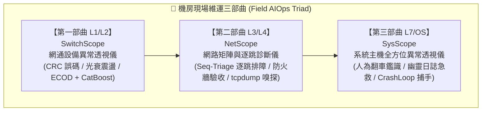

# ⬡ SysScope — 系統主機全方位異常透視儀 (Master Host Doctor)

> **機房現場維運三部曲 · 第三部曲 (L7 / OS 核心主機篇)**  
> **「人機協同 · 現場賦能」** —— 獻給每一位在機房第一線深夜排障的系統工程師。  
> 聯合架構設計：**Kerr & Google Gemini**

[](https://github.com/)
[-green?style=flat-square)](https://www.python.org/)
[](https://pypi.org/)
[](https://csrc.nist.gov/)
[](LICENSE)

---

## 📖 專案背景與維運三部曲定位

在現代混合雲與企業地端機房中，當系統發生故障時，維運工程師常面臨跨層級的排障盲區。為此，我們打造了**機房現場維運三部曲 (Field AIOps Triad)**：



### 為什麼不需要為幾千種服務各寫一套外掛？
Linux 上的應用千百種（Nginx、ELK、PostgreSQL、MySQL、Redis、Docker、K8s Node、GitLab...）。如果每個軟體都要寫特定剖析器，維運工具將無比龐大且脆弱。  
**`SysScope` 抓住所有 Linux 服務共用的 6 大生命線**：
1. **人為行為線**：85% 故障源自**故障發生前半小時內的人為危險指令** (`history`)。
2. **儲存生命線**：磁碟滿載 (`df -h 100%`)、Inode 耗盡 (`df -i 100%`)、被刪除卻佔用空間的**幽靈日誌** (`lsof +L1`)。
3. **行程存活線**：全域 Systemd 崩潰 (`systemctl status` / `systemctl --failed`)、無限重啟 (`CrashLoopBackOff`)、埠位衝突 (`EADDRINUSE`)。
4. **記憶體邊界**：Linux 核心斬首行程記錄 (`dmesg -T` OOM-Killer 現場還原)。
5. **重啟安全性**：開機鎖死急診室 (`/etc/fstab` 遠端掛載遺漏 `_netdev,nofail`、唯讀磁區鎖定)。
6. **核心監聽線**：通訊埠綁定陷阱 (`127.0.0.1` 內外隔離盲點)、核心連線追蹤表 (`conntrack full`)。

只要守住這 6 大生命線，**無論上層跑的是什麼服務，故障原因皆無所遁形！**

---

## 🧭 Cisco「show tech-support」旗艦架構：全景大會診 (All-in-One Master Panorama ⭐ Kerr's Vision)

現場排障最怕「查這個漏那個、跨分頁鬼打牆、各指標沒有上下文連貫」！  
SysScope 借鏡 Cisco 網路權威的 **`show tech-support`** 理念，推出**一鍵全景大會診**：

### 1. 現場 1 行指令採集全景 (One-Liner Tech-Support Collector)
工程師只需在出事主機貼上以下指令，SysScope 自動智慧解多工 (Smart Demux)：
```bash
(echo "=== [1] HISTORY ==="; HISTTIMEFORMAT="%F %T " history 300 2>/dev/null || cat ~/.bash_history 2>/dev/null | tail -n 300; echo "=== [2] SYSTEMD ==="; systemctl --failed --no-pager 2>/dev/null; journalctl -p 3 -xb -n 30 --no-pager 2>/dev/null; echo "=== [3] DISK ==="; df -h; echo "---"; df -i; lsof +L1 2>/dev/null | grep deleted | head -n 30; echo "=== [4] MEM_OOM ==="; free -m; dmesg -T 2>/dev/null | grep -Ei "oom|killed process|out of memory" | tail -n 30; echo "=== [5] REBOOT ==="; cat /etc/fstab 2>/dev/null; cat /proc/mounts 2>/dev/null; echo "=== [6] NETWORK ==="; ss -tulpn 2>/dev/null)
```

### 2. 跨維度連鎖反應因果鏈推演 (Cross-Context Incident Chains)
不同維度的訊息不再孤立，SysScope 自動重構連鎖因果鏈：
* 🔗 **因果鏈 A (人為指令 ➔ OOM 斬首)**：維運敲下 `swapoff -a` ➔ 實體記憶體瞬時枯竭 ➔ Linux 核心 OOM Killer 拔刀槍斃 `mysqld`。
* 🔗 **因果鏈 B (人為指令 ➔ 幽靈硬碟爆滿)**：維運敲下 `rm -rf /var/log/catalina.out` ➔ Java 進程未釋放 FD ➔ `df -h` 依舊 100% 爆滿 (咬住 46GB)。
* 🔗 **因果鏈 C (端口衝突 ➔ 服務崩潰)**：`systemctl restart nginx` 失敗 ➔ 交叉核對發現 Port 80 早被舊進程 `apache2` 霸佔！
* 🔗 **因果鏈 D (清空防火牆 ➔ 容器斷網)**：維運敲下 `iptables -F` ➔ Docker NAT 轉發鏈蒸發 ➔ 所有容器外網連線全斷。
* 🔗 **因果鏈 E (設定地雷 ➔ 重啟死機)**：`/etc/fstab` 掛載 NFS 缺少 `_netdev,nofail` ➔ 下次維護重開機時主機必死於 Emergency Mode。

### 3. 主機綜合健康指數 (0~100) 與急診處方籤 (Prioritized Worklist)
* 系統自動計算綜合健康評分，並依據事故緻死急迫性產出 **P1 (服務復原) / P1 (空間秒釋) / P1 (網路搶救) / P2 (防患未然)** 處方籤，附帶一鍵複製指令。
* 提供【📋 一鍵複製完整交班大通報】，格式整齊，直接發送至 LINE / Teams 群組完成事故通報。

---

## 🌟 核心功能特色 (6 大診斷引擎)

### 1. 🕵️ 指令歷史與人為翻車鑑識 (History Forensic ⭐ Kerr's Vision)
* **痛點**：「服務突然掛了，工程師都說『我什麼都沒改』！」50 筆指令不夠看，需要深入剖析 100~1000 筆。
* **透視**：深度稽核 Bash History / Zsh History。
* **30+ 種致命與高危指令規則庫**：
  * 防火牆暴衝：`iptables -F`、`iptables -X`、`ufw disable`（抹除 Docker 轉發或阻擋 SSH）
  * 權限失控：`chmod -R 777 /`、`chmod 777 ~/.ssh`（引發 OpenSSH 拒絕金鑰登入）
  * 記憶體自殺：`swapoff -a`（直接觸發暴烈式 OOM 滅頂）
  * 檔案蒸發：`rm -rf /*`、手動刪除運行中日誌造成幽靈空間 (`rm /var/log/*.log`)
  * 供應鏈威脅：`curl | bash`、覆寫全域系統 Python pip (`pip install --break-system-packages`)
  * 網路自殺：`route del default`、`ip route del default`（瞬間斷網）
  * 密碼外洩檢測：終端機明文暴露之 `mysql -p...`、`curl -u user:pass`、`TOKEN=...`
* **8 大維運行為雷達分類**：
  * ⚙️ 設定檔修改 (Config)、🔄 服務操作 (Service)、🌐 網路異動 (Network)、📦 套件管理 (Package)、🛡️ 權限安全 (Security)、💾 磁碟儲存 (Storage)、🗄️ 資料庫 (Database)、🔍 日誌巡檢 (Diagnostic)。
* **⚡ 事故導火線關聯鏈 (Correlation Insight)**：
  * 自動比對「編輯設定檔（如 `vim /etc/nginx/nginx.conf`）➔ 緊接著重啟服務（`systemctl restart nginx`）」之因果鏈，精準鎖定人為事故導火線！
* **互動篩選時間軸**：前端支援點選標籤即時篩選（只看高危、只看設定檔變更、只看服務重啟）。

### 2. 💽 磁碟空間與幽靈日誌急救站 (Ghost Disk & Inode Doctor)
* **痛點**：現場人員執行 `rm -f app.log` 刪除了超大日誌，但 `df -h` 顯示磁碟空間依然 100% 爆滿！
* **原理解密**：Linux 中，當進程仍持有檔案描述符（File Descriptor）時，刪除檔案僅移除目錄指標，磁區根本不會釋放（即 `(deleted)` 狀態）。
* **急救解方**：
  * 自動剖析 `lsof +L1`，抓出佔用磁碟的殭屍行程、PID 與 FD 編號。
  * **一鍵生成零重啟急救指令**：`echo "" > /proc/<PID>/fd/<FD>`，免重啟守護進程即可瞬間清空底層 Inode！
  * 同步檢查 Inode 耗盡 (`df -i 100%`，常見於郵件隊列或 Session 碎檔) 與 Docker Overlay2 膨脹。

### 3. 🚨 Systemd 全域服務崩潰捕手 (CrashLoop & Port Conflict Catcher)
* **痛點**：服務掛掉時，新手根本不知道該看哪支日誌、指令該怎麼打。
* **多格式原生支援**：
  * 支援直接貼入最常用的 **`systemctl status <服務名稱>`**（解析 Active: failed, Process, Exit Code, Description）。
  * 支援全主機崩潰表格 **`systemctl --failed`**（相容各發行版 `●` 與 `*` 格式）。
  * 支援直接貼入 **`journalctl -xe`**、Docker 報錯日誌與應用 Crash 堆疊。
* **自動分類診斷**：
  * 🔌 `PORT_CONFLICT`：偵測到 `Address already in use` (`EADDRINUSE`)，精準提取出衝突的 Port 號碼（例如 Port 80、8080），並一鍵生成 `ss -tulpn | grep :<port>` 與 `fuser -k <port>/tcp` 強制釋放指令！
  * 🔄 `CRASH_LOOP`：捕捉 `activating (auto-restart)` 與 `CrashLoopBackOff`，識別 Systemd 限流保護 (`start request repeated too quickly`)，提供 `systemctl reset-failed` 重置指令。
  * 🚫 `PERMISSION_DENIED`：檔案或通訊端存取被拒 (EACCES)。
  * ⚙️ `CONFIG_SYNTAX_ERROR`：設定檔語法錯誤，自動推薦語法測試指令（如 `nginx -t`, `apachectl configtest`, `sshd -t`）。
  * 💀 `MISSING_DEPENDENCY`：找不到執行檔或動態函式庫 (.so)。

### 4. 🔪 OOM Killer 案發現場還原 (OOM Forensic)
* **痛點**：MySQL 或 Java 進程無預警消失，日誌裡沒有任何 Crash 記錄。
* **透視**：解析核心環形緩衝區 `dmesg -T`。
* **現場還原**：
  * 標註被核心屠宰的犧牲者行程名稱、PID、釋放的記憶體總量。
  * **深度判別**：區分是「整台 Host 實體記憶體耗盡」還是「容器 Cgroup 限制 (`Memory cgroup out of memory`) 超標」。

### 5. 💣 重開機安全驗收雷達 (Reboot Readiness & fstab Hazard Audit)
* **痛點**：工程師掛載了 NFS/CIFS 或新增硬碟，忘記加上參數，結果維護重開機時主機直接卡死在 `Emergency Mode`，必須接實體 Console 線進機房救援！
* **透視**：嚴密檢驗 `/etc/fstab` 與 `/proc/mounts`。
* **致命雷區警告**：
  * 網路掛載遺漏 `_netdev`（導致網路未啟動前掛載失敗死機）。
  * 缺少 `nofail` 容錯宣告（導致磁區逾時開機停擺）。
  * 檔案系統轉為唯讀 `ro` 狀態（通常代表底層儲存硬體或 RAID 卡報警）。

### 6. 🔌 核心網路連線與 Port 綁定診斷 (Kernel Network & Localhost Trap)
* **痛點**：「服務明明啟動了，在主機上 curl 也通，但外部使用者就是連不進來！」
* **透視**：解析 `ss -tulpn` 或 `netstat`。
* **陷阱抓漏**：
  * **Localhost Trap**：監聽綁定在 `127.0.0.1:<PORT>`，導致非本機流量全被丟棄（應改為 `0.0.0.0` 或專屬 IP）。
  * **Conntrack 爆滿**：解析 `nf_conntrack: table full, dropping packet` 核心丟包。

---

## 🛡️ 企業資安與無損設計原則 (Non-Invasive Principles)

1. **0 外部 Pip 依賴 (Supply Chain Security First ⭐)**：
   * 核心伺服器與鑑識模組 100% 以 Python 3 原生標準庫編寫（`http.server`, `re`, `json`, `subprocess`, `urllib`）。
   * 絕不安裝不可信的第三方 PyPI 套件，杜絕軟體供應鏈投毒。
2. **零硬碟殘留 (Zero-Disk-Retention ⭐)**：
   * 所有上傳的日誌、指令歷史與診斷數據，**僅在記憶體（RAM）中完成毫秒級揮發性運算**。
   * 全站 API 回應標頭均帶有 `Cache-Control: no-store, no-cache, must-revalidate`，不在客戶端與伺服器留下任何文字軌跡。
3. **100% 唯讀安全 (Read-Only / Human-in-the-Loop)**：
   * 系統不主動發送破壞性修復指令，不隨意殺死 Process。
   * 診斷報告提供**透明且可驗證的白話說明與一鍵複製指令**，由現場工程師確認後親手執行。
4. **確定性工程優先 · 零幻覺斷網神兵 (Deterministic First ⭐ Kerr's Philosophy)**：
   * **「沒 AI 時這就很好用！」**—— 拒絕把未清洗的雜亂日誌丟給 LLM 瞎猜。全系統優先以確定性因果鏈與領域專家啟發式推演打底，0.01 秒完成 0 幻覺、純 RAM 揮發診斷；AI 是放大器而非地基。

---

## 🚀 快速開始 (跨平台支援)

SysScope 支援在任意 **Linux**、**macOS** 或 **Windows** 環境上一鍵啟動：

### 🐧 Linux / 🍎 macOS
```bash
# 賦予執行權限並啟動 (自動偵測 python3 / python 並開啟瀏覽器)
chmod +x run.sh
./run.sh
```

### 🪟 Windows (雙軌啟動器)
* **方式 1**：在檔案總管中，直接雙擊 `啟動服務.bat`。
* **方式 2**：透過 PowerShell 執行：
  ```powershell
  .\launcher.ps1
  ```
* **方式 3**：原生 Python 指令：
  ```powershell
  python server.py
  ```

啟動後，瀏覽器將自動開啟控制台：`http://localhost:8940/`。

---

## 🎯 現場人員小白指引 (設計給「什麼都不懂的人」)

為了貫徹極簡的現場操作體驗：

1. **一鍵帶入示範案例 (One-Click Demo Presets)**：
   * 界面上方備有多種常見事故範例快速按鈕，現場工程師點擊即可立刻觀摩鑑識結果。
2. **直覺白話診斷結論**：
   * 捨棄看不懂的 Linux 核心報錯代碼，直接用紅字/綠字卡片顯示結論、責任歸屬與處置方案。
3. **一鍵複製 LINE / Teams 交班通報**：
   * 點擊【📋 複製 LINE / Teams 現場回報單】，自動格式化為整齊的 Markdown 文字，直接貼到主管或團隊群組，一秒完成事故通報！

---

## 🧪 單元測試驗證

本專案自帶完整的自動化測試套件，涵蓋 6 大診斷引擎與各類異常格式：

```bash
python test_engine.py
```

測試驗證成果：
```text
Ran 10 tests in 0.010s

OK
[OK] DiskDoctor correctly identified ghost file: /var/log/catalina.out (46053.9 MB)
[OK] HistoryForensic caught 6 suicidal commands and 1 correlation insights
[OK] MasterSynthesizer successfully synthesized Cisco tech-support bundle: Score=5/100, Chains=6, Worklist=6
[OK] NetKernelAudit caught Localhost trap on port 8080
[OK] OOMForensic reconstructed victim: mysqld (PID: 18291)
[OK] RebootReadiness caught fstab hazard: score 30 (NFS missing _netdev)
[OK] SystemdCatcher correctly caught CrashLoopBackOff on myapp-worker.service!
[OK] SystemdCatcher successfully parsed real systemctl status: unit=nginx.service, port=['80']
[OK] SystemdCatcher correctly diagnosed configuration syntax error and suggested nginx -t!
[OK] SystemdCatcher caught crashed nginx.service from table with EADDRINUSE!
```

---

## 🤝 貢獻與開發致謝

本專案由 **Kerr** 與 **Google Gemini** 聯手打造。
> **「人機協同 · 現場賦能」**  
> 科技的本質是賦能。再複雜的系統、再嚴峻的機房現場，只要架構清晰、方法正確，AI 都能成為工程師最可靠的破案偵探與最強大的副駕駛。
