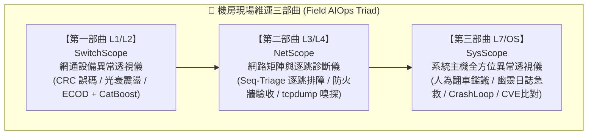

# ⬡ SysScope — 系統主機全方位異常透視儀 (Master Host Doctor)

<div align="center">

[]()
[-blue.svg)](https://www.python.org/)
[](https://pypi.org/)
[]()
[]()
[]()
[](LICENSE)
[]()

**專為系統管理員、SRE、資安調查官與機房駐點工程師打造的 L7/OS 現場全方位排障神器！**  
**100% 地端離線運算 ｜ 純標準庫零依賴 ｜ 幽靈空間秒級釋放 ｜ 人為翻車鑑識 ｜ Cisco 全景大會診 ｜ OSV 官方 CVE 比對**

</div>

---

## 📖 專案背景與維運三部曲定位

在現代混合雲與企業地端機房中，當系統發生故障時，維運工程師常面臨跨層級的排障盲區。為此，我們打造了**機房現場維運三部曲 (Field AIOps Triad)**：



### 為什麼不需要為幾千種服務各寫一套外掛？
Linux 上的應用千百種（Nginx、ELK、PostgreSQL、MariaDB、Redis、Docker、K8s Node、GitLab...）。如果每個軟體都要寫特定剖析器，維運工具將無比龐大且脆弱。  
**`SysScope` 抓住所有 Linux 服務共用的 7 大生命線**：
1. **人為行為線**：85% 故障源自**故障發生前半小時內的人為危險指令** (`history`)。
2. **儲存生命線**：磁碟滿載 (`df -h 100%`)、Inode 耗盡 (`df -i 100%`)、被刪除卻佔用空間的**幽靈日誌** (`lsof +L1`)。
3. **行程存活線**：全域 Systemd 崩潰 (`systemctl status` / `systemctl --failed`)、無限重啟 (`CrashLoopBackOff`)、埠位衝突 (`EADDRINUSE`)。
4. **記憶體邊界**：Linux 核心斬首行程記錄 (`dmesg -T` OOM-Killer 現場還原)。
5. **重啟安全性**：開機鎖死急診室 (`/etc/fstab` 遠端掛載遺漏 `_netdev,nofail`、唯讀磁區鎖定)。
6. **核心監聽線**：通訊埠綁定陷阱 (`127.0.0.1` 內外隔離盲點)、核心連線追蹤表 (`conntrack full`)。
7. **核心與弱點安全線**：核心更新後未重開機 (`reboot-required`)、發行版 Backport CVE 弱點精確比對。

只要守住這 7 大生命線，**無論上層跑的是什麼服務，故障原因皆無所遁形！**

---

## 🌟 為什麼需要 SysScope？

在維護 Linux / Unix 企業級主機時，工程師經常面臨五大現場維運折磨：

1. **文字海嘯，日誌跨維度孤島難以串接**：
   敲了 `df`, `free`, `dmesg`, `systemctl`, `journalctl`, `history` 幾萬行，各分頁資訊孤立，看不出連鎖反應，關鍵線索隱沒在海量輸出中。
2. **空間蒸發卻找不到檔案（幽靈日誌佔滿磁碟）**：
   敲了 `rm -f app.log` 刪除了超大日誌，`df -h` 依舊 100% 爆滿！因為進程未關閉 FD (deleted but open) 咬住底層 Inode，重啟守護進程又怕中斷核心業務。
3. **人為指令自殺，事後「我什麼都沒改」**：
   85% 故障源自前 30 分鐘的人為操作（`swapoff -a` 引發暴烈式 OOM 滅頂、`iptables -F` 沖毀 Docker 轉發、`chmod 777` 導致 OpenSSH 拒絕金鑰登入）。
4. **OOM 斬首無聲無息 & 重開機卡死在 Emergency Mode**：
   進程被 Linux 核心 OOM-Killer 斬首無 Crash 日誌；`/etc/fstab` 缺少 `_netdev,nofail`，下次維護重啟時伺服器直接死在機房，必須接實體 Console 線救援。
5. **CVE 漏洞盲區無從查起，盲猜版本頻頻誤報**：
   不清楚當前跑的是哪個 Kernel、更新後**是否尚未重開機**；上游發行版（Ubuntu/Debian）Backport 補丁是否已修復，純看上游版本號只會產生滿江紅假警報。

---

## 📊 方案對比表 (Feature Comparison)

| 功能特點 / 解決方案 | 傳統人工手動排障 | 公開雲端 AI (ChatGPT) | 昂貴監控平台 (Zabbix/Datadog) | ⬡ SysScope 本地全方位透視儀 |
| :--- | :---: | :---: | :---: | :---: |
| **資安合規 (100% 斷網運行)** | ✅ 免上雲 | ❌ **嚴重資安違規 (外洩配置)** | ⚠️ 需建置龐大地端 Server | 🏆 **100% 本機離線、氣隙環境可用** |
| **依賴性與安裝門檻** | 零門檻 | 需聯網與付費帳號 | 依賴資料庫、Agent、龐大生態 | 🚀 **純 Python 3 標準庫、0 外部 Pip** |
| **幽靈日誌免重啟急救** | ❌ 需熟記 lsof 與 fd 指令 | ⚠️ 容易給出需重啟服務的建議 | ❌ 僅告警磁碟滿，不解幽靈 FD | 🛠️ **一鍵生成 `/proc/<pid>/fd` 零停機清空** |
| **人為翻車鑑識與因果鏈** | 🐢 翻查 history 肉眼比對 | ⚠️ 上下文遺忘、易產生幻覺 | ❌ 不稽核終端指令歷史 | ⚡ **30+ 種致命指令庫 + 事故導火線分析** |
| **OOM-Killer 案發現場還原** | 🐢 查 dmesg 計算記憶體頁面 | ⚠️ 難區分 Host 耗盡或 Cgroup | ⚠️ 僅顯示進程重啟 | 🔪 **秒還原被斬首 PID、名稱與記憶體釋放** |
| **重開機安全雷達 (fstab)** | ❌ 容易疏漏，重啟死機才發現 | ⚠️ 需手動貼出 fstab 詢問 | ❌ 普遍不審計掛載參數容錯 | 💣 **抓出缺 `_netdev,nofail` 的開機地雷** |
| **發行版 CVE 比對 (Backport)** | 🐢 人工比對 USN/Debian 安全公告 | ❌ upstream 版本號比對頻頻誤報 | ⚠️ 需昂貴漏洞掃描模組授權 | 🛡️ **dpkg 演算法對齊 OSV.dev，驗證重啟狀態** |
| **全景大會診輸出** | ❌ 跨視窗碎片化截圖 | ⏳ 需等待幾十秒串流回覆 | ⚠️ 儀表板圖表分散 | 👑 **Cisco show tech-support 風格一鍵彙整** |
| **現場除錯與主動自愈執行** | ❌ 需手動敲指令、易打錯手抖 | ❌ 僅出嘴巴，無本機/遠端執行通道 | ❌ 僅唯讀監控，無自愈閉環 | ⚡ **雙模執行 (本機/SSH)、安全守衛阻斷高危、一鍵自動除錯自愈** |

---

## 🚀 Cisco「show tech-support」旗艦架構：全景大會診 (All-in-One Master Panorama)

現場排障最怕「查這個漏那個、跨分頁鬼打牆、各指標沒有上下文連貫」！  
SysScope 借鏡 Cisco 網路權威的 **`show tech-support`** 理念，推出**一鍵全景大會診**：

```
                    ┌─────────────────────────┐
                    │ Linux Host 現場一行採集 │
                    └────────────┬────────────┘
                                 │
                 (智慧解多工 Smart Demux 結構化)
                                 │
                                 ▼
┌────────────────────────────────────────────────────────┐
│ 第一層：跨維度連鎖反應因果鏈推演 (Incident Chains)       │
│  🔗 因果鏈 A：維運指令 (swapoff) ➔ OOM 斬首 (mysqld)   │
│  🔗 因果鏈 B：人為刪除 (rm log) ➔ 幽靈硬碟爆滿 (46GB) │
│  🔗 因果鏈 C：端口衝突 (Port 80) ➔ Nginx 重啟失敗      │
│  🔗 因果鏈 D：清空防火牆 (iptables -F) ➔ Docker 斷網   │
│  🔗 因果鏈 E：NFS 缺參數 ➔ 下次重啟必死於 Emergency     │
└────────────────────────────────┬───────────────────────┘
                                 │
           ┌─────────────────────┴─────────────────────┐
           ▼                                           ▼
 [主機綜合健康指數 (0~100)]                  [急診優先級處方籤 (Worklist)]
 計算扣分項目與致命危險程度                  P1 (立即復原) / P2 (預防死機) 附帶一鍵指令
```

### 現場 1 行指令採集全景 (One-Liner Tech-Support Collector)
工程師只需在出事主機貼上以下指令，SysScope 自動智慧解多工 (Smart Demux)：
```bash
(echo "=== [1] HISTORY ==="; HISTTIMEFORMAT="%F %T " history 300 2>/dev/null || cat ~/.bash_history 2>/dev/null | tail -n 300; echo "=== [2] SYSTEMD ==="; systemctl --failed --no-pager 2>/dev/null; journalctl -p 3 -xb -n 30 --no-pager 2>/dev/null; echo "=== [3] DISK ==="; df -h; echo "---"; df -i; lsof +L1 2>/dev/null | grep deleted | head -n 30; echo "=== [4] MEM_OOM ==="; free -m; dmesg -T 2>/dev/null | grep -Ei "oom|killed process|out of memory" | tail -n 30; echo "=== [5] REBOOT ==="; cat /etc/fstab 2>/dev/null; cat /proc/mounts 2>/dev/null; echo "=== [6] NETWORK ==="; ss -tulpn 2>/dev/null)
```

---

## 🖥️ 介面預覽 (Dashboard Architecture)

```
┌─────────────────────────────────────────────────────────────────────────────────────────────────────────┐
│ ⬡ SysScope   [👑 全景大會診] [🕵️ 指令歷史] [💽 幽靈空間] [🚨 服務崩潰] [🔪 OOM鑑識] [💣 重開機] [🔌 網路] [🛡️ CVE] │
├────────────────────────┬───────────────────────────────────────────┬────────────────────────────────────┤
│ 📋 現場日誌輸入區       │ 👑 主機健康指數 (Host Health Score: 5/100) │ 📝 現場急診處方籤 (Prioritized Rx) │
│  [載入範例 ▼]          │  [🔴 CRITICAL: 主機面臨停擺高危風險]        │                                    │
│  - 幽靈日誌 46GB 塞滿  │  - 扣分項: 幽靈日誌咬住 (-35)、OOM斬首(-30)│ P1 立即釋放空間 (免重啟):          │
│  - 人為翻車 swapoff    ├───────────────────────────────────────────┤ `echo "" > /proc/18291/fd/4`       │
│  - 服務崩潰 EADDRINUSE │ 🔗 事故因果鏈推演 (Incident Chains)       │                                    │
│  - fstab 掛載遺漏參數  │  - 因果鏈 1: rm catalina.out ➔ 幽靈爆滿   │ P1 釋放衝突端口:                   │
│  - CVE 比對 (OSV.dev)  │  - 因果鏈 2: swapoff -a ➔ MySQL 遭斬首   │ `fuser -k 80/tcp`                  │
│                        │  - 因果鏈 3: fstab NFS 缺 _netdev ➔ 死機  │                                    │
│ [🚀 開始一鍵全景診斷]  ├───────────────────────────────────────────┤ 📋 一鍵複製交班大通報              │
│                        │ 🛡️ 官方 CVE 比對 (Google OSV.dev)         │  [自動產出 LINE / Teams 通報格式]   │
│ [即時本機掃描 (Linux)] │  - Linux Kernel: 6.8.0-110 (需重開機生效) │                                    │
│                        │  - CVE-2024-1086: 🔴 需更新套件           │                                    │
└────────────────────────┴───────────────────────────────────────────┴────────────────────────────────────┘
```

---

## 💎 八大核心模組

### 模組 0：👑 Cisco Tech-Support 全景大會診與因果鏈推演 (Master Panorama ⭐ Kerr's Vision)
* **主震央裁決**：自動從全機雜訊中，精準抓出最致命的核心故障（如磁碟 100% 爆滿、核心進程遭 OOM 屠宰、NFS 開機死機地雷）。
* **跨維度連鎖反應因果鏈 (Cross-Context Chains)**：自動串接指令歷史、空間狀態與進程崩潰，還原人為翻車真相。
* **急診處方籤 (Prioritized Worklist)**：產出 P1 (服務復原) / P1 (空間秒釋) / P2 (預防死機) 具體指令。
* **一鍵交班通報**：點擊即可複製整齊的 Markdown 事故通報單，直接發送至 LINE / Teams 群組。

### 模組 1：🕵️ 指令歷史與人為翻車鑑識 (History Forensic ⭐ Kerr's Vision)
* **痛點**：「服務突然掛了，工程師都說『我什麼都沒改』！」
* **透視**：深度稽核 Bash History / Zsh History 100~1000 筆紀錄。
* **30+ 種致命與高危指令規則庫**：
  * 防火牆暴衝：`iptables -F`、`iptables -X`、`ufw disable`（抹除 Docker 轉發或阻擋 SSH）
  * 權限失控：`chmod -R 777 /`、`chmod 777 ~/.ssh`（引發 OpenSSH 拒絕金鑰登入）
  * 記憶體自殺：`swapoff -a`（直接觸發暴烈式 OOM 滅頂）
  * 檔案蒸發：`rm -rf /*`、手動刪除運行中日誌造成幽靈空間 (`rm /var/log/*.log`)
  * 供應鏈威脅：`curl | bash`、覆寫全域系統 Python pip (`pip install --break-system-packages`)
  * 網路自殺：`route del default`、`ip route del default`（瞬間斷網）
* **⚡ 事故導火線關聯鏈**：自動比對「編輯設定檔（`vim nginx.conf`）➔ 緊接著重啟服務（`systemctl restart nginx`）」之因果鏈！

### 模組 2：💽 磁碟空間與幽靈日誌急救站 (Ghost Disk & Inode Doctor)
* **痛點**：現場人員執行 `rm -f app.log` 刪除了超大日誌，但 `df -h` 顯示磁碟空間依然 100% 爆滿！
* **急救解方**：
  * 自動剖析 `lsof +L1`，抓出佔用磁碟的殭屍行程、PID 與 FD 編號。
  * **一鍵生成零重啟急救指令**：`echo "" > /proc/<PID>/fd/<FD>`，免重啟守護進程即可瞬間清空底層 Inode！
  * 同步檢查 Inode 耗盡 (`df -i 100%`) 與 Docker Overlay2 膨脹。

### 模組 3：🚨 Systemd 全域服務崩潰捕手 (CrashLoop & Port Conflict Catcher)
* **多格式原生支援**：支援貼入 `systemctl status <服務>`、全主機崩潰表 `systemctl --failed`、以及 `journalctl -xe`。
* **精準死因識別**：
  * 🔌 `PORT_CONFLICT`：偵測到 `Address already in use` (`EADDRINUSE`)，精準提取衝突 Port，產出 `fuser -k <port>/tcp` 指令。
  * 🔄 `CRASH_LOOP`：捕捉 `activating (auto-restart)` 與限流保護 (`start request repeated too quickly`)。
  * ⚙️ `CONFIG_SYNTAX_ERROR`：設定檔語法錯誤，自動推薦語法測試指令（如 `nginx -t`, `sshd -t`）。
  * 🚫 `PERMISSION_DENIED`：檔案或通訊端存取被拒 (EACCES)。

### 模組 4：🔪 OOM Killer 案發現場還原 (OOM Forensic)
* **痛點**：MySQL 或 Java 進程無預警消失，應用日誌裡沒有任何 Crash 記錄。
* **現場還原**：
  * 解析核心環形緩衝區 `dmesg -T`。
  * 標註被核心屠宰的犧牲者行程名稱、PID、釋放的記憶體總量。
  * **深度判別**：區分是「整台 Host 實體記憶體耗盡」還是「容器 Cgroup 限制 (`Memory cgroup out of memory`) 超標」。

### 模組 5：💣 重開機安全驗收雷達 (Reboot Readiness & fstab Hazard Audit)
* **痛點**：工程師掛載了 NFS/CIFS 或新增硬碟，忘記加上參數，結果維護重開機時主機直接卡死在 `Emergency Mode`！
* **致命雷區警告**：
  * 網路掛載遺漏 `_netdev`（導致網路未啟動前掛載失敗死機）。
  * 缺少 `nofail` 容錯宣告（導致磁區逾時開機停擺）。
  * 檔案系統轉為唯讀 `ro` 狀態（底層儲存硬體或 RAID 卡報警）。

### 模組 6：🔌 核心網路連線與 Port 綁定診斷 (Kernel Network & Localhost Trap)
* **痛點**：「服務明明啟動了，在主機上 curl 也通，但外部使用者連不進來！」
* **陷阱抓漏**：
  * **Localhost Trap**：監聽綁定在 `127.0.0.1:<PORT>`，導致外部流量全被丟棄（應改為 `0.0.0.0` 或專屬 IP）。
  * **Conntrack 爆滿**：解析 `nf_conntrack: table full, dropping packet` 核心丟包。

### 模組 7：🛡️ 發行版 CVE 弱點比對與 Kernel 白話狀態 (CVE & Kernel Audit)
* **痛點**：盲猜版本頻頻誤報、不知道核心已更新但「尚未重開機」導致修補未生效。
* **技術亮點**：
  * 不拿上游版本號盲目比對，一律比對**發行版官方公告修復版本**（資料來源 Google OSV.dev 之 Ubuntu / Debian 公告）。
  * 採用真實 **dpkg 版本比較演算法 (`deb_compare`)**，解決 Backport 誤報問題。
  * 精準白話判定：`已修復`、`需更新套件`、`需重開機才生效`、`尚無修復版本`。
  * 支援獨立 CLI 指令：`python3 cve_check.py --cve CVE-2024-1086`，亦可製作離線資料包 (`build-pack`) 供氣隙環境使用。

### 模組 8：⚡ 現場除錯指令執行與主動自愈引擎 (Live Remedy & Auto-Healing Engine)
* **痛點**：「檢查出問題了，但現場工程師不敢動手，或者敲錯指令二次翻車！」
* **技術亮點**：
  * **雙模執行引擎 (`remedy_executor.py`)**：支援本地本機 Subprocess 執行，以及遠端 SSH (Paramiko) 執行通道，自動處理 `sudo` 提權密碼管道注入。
  * **安全防護閘門 (Safe Guardrail)**：硬性攔截自殺性破壞指令（`rm -rf /`、`mkfs`、`dd of=/dev/`、Fork Bomb、`shutdown` 等），嚴守生產安全底線。
  * **一鍵自動修復全部處方 (One-Click Auto Remediation)**：在全景大會診中點擊按鈕，自動依優先級依序在目標主機下達除錯與止血指令，毫秒級即時反饋 Exit Code、執行時間與輸出，達成「診斷 ➔ 處方 ➔ 下達 ➔ 驗收」的完整 AIOps 自愈閉環！
  * **遠端一鍵 SSH 全景會診**：在前端直接填入目標主機 IP/帳密，一鍵完成遠端採集、自動剖析與即時除錯。

---

## 🛡️ 企業資安與無損設計原則 (Non-Invasive Principles)

1. **0 外部 Pip 依賴 (Supply Chain Security First ⭐)**：
   - 核心伺服器與鑑識模組 100% 以 Python 3 原生標準庫編寫（`http.server`, `re`, `json`, `subprocess`, `urllib`）。
   - 絕不安裝不可信的第三方 PyPI 套件，杜絕軟體供應鏈投毒。
2. **零硬碟殘留 (Zero-Disk-Retention ⭐)**：
   - 所有上傳的日誌、指令歷史與診斷數據，**僅在記憶體（RAM）中完成毫秒級揮發性運算**。
   - 全站 API 回應標頭均帶有 `Cache-Control: no-store, no-cache, must-revalidate`，不在客戶端與伺服器留下任何文字軌跡。
3. **100% 唯讀安全 (Read-Only / Human-in-the-Loop)**：
   - 系統不主動發送破壞性修復指令，不隨意殺死 Process。
   - 診斷報告提供**透明且可驗證的白話說明與一鍵複製指令**，由現場工程師確認後親手執行。
4. **確定性工程優先 · 零幻覺斷網神兵 (Deterministic First ⭐ Kerr's Philosophy)**：
   - **「沒 AI 時這就很好用！」**—— 拒絕把未清洗的雜亂日誌丟給 LLM 瞎猜。全系統優先以確定性因果鏈與領域專家啟發式推演打底，0.01 秒完成 0 幻覺、純 RAM 揮發診斷；AI 是放大器而非地基。

---

## 🚀 快速開始 (跨平台支援)

SysScope 支援在任意 **Linux**、**macOS** 或 **Windows** 環境上一鍵啟動：

### 🐧 Linux / 🍎 macOS
```bash
# 賦予執行權限並啟動 (自動偵測 python3 / python 並開啟瀏覽器)
chmod +x run.sh
./run.sh
```

### 🪟 Windows (雙軌啟動器)
- **方式 1**：在檔案總管中，直接雙擊 `啟動服務.bat`。
- **方式 2**：透過 PowerShell 執行：
  ```powershell
  .\launcher.ps1
  ```
- **方式 3**：原生 Python 指令：
  ```powershell
  python server.py
  ```

啟動後，瀏覽器將自動開啟控制台：`http://localhost:8940/`。

### 🛡️ CVE 獨立命令列工具 (`cve_check.py`)
```bash
# 1. 本機掃描：只看 kernel 狀態與待安裝安全更新
python3 cve_check.py

# 2. 比對特定 CVE 編號
python3 cve_check.py --cve CVE-2024-1086 CVE-2024-3094

# 3. 應用程式層級 CVE 比對 (如 LibreNMS)
python3 cve_check.py --cve CVE-2026-84190 --app-version 26.10.0

# 4. 印出目標主機的一行收集指令
python3 cve_check.py collector

# 5. 製作斷網離線資料包
python3 cve_check.py build-pack --cve CVE-2024-1086 --eco Ubuntu:22.04:LTS --out pack.json
python3 cve_check.py --pack pack.json --offline --cve CVE-2024-1086
```

---

## 📁 專案目錄結構

```text
SysScope/
  ├── core/
  │    ├── remedy_executor.py    # 現場除錯與主動自愈執行器 (本機/SSH 雙模、安全守衛、Sudo 提權)
  │    ├── master_synthesizer.py # Cisco 全景大會診核心與因果鏈推演引擎
  │    ├── history_forensic.py   # 指令歷史與人為翻車鑑識模組 (30+ 致命規則)
  │    ├── disk_doctor.py        # 磁碟空間與幽靈日誌急救站 (lsof +L1 剖析)
  │    ├── systemd_catcher.py    # 全域服務崩潰捕手 (CrashLoop & 端口衝突)
  │    ├── oom_forensic.py       # OOM-Killer 案發現場還原器 (dmesg -T)
  │    ├── reboot_readiness.py   # 重開機安全驗收雷達 (fstab / mounts 審計)
  │    ├── net_kernel_audit.py   # 核心網路與通訊埠綁定診斷 (Localhost trap)
  │    └── cve_audit.py          # Google OSV.dev 發行版 CVE 比對引擎
  ├── web/
  │    └── index.html            # 純原生前端戰情儀表板 (8 大分頁切換 + 現代深色 UI)
  ├── samples/                   # 內建真實維運故障測試日誌包
  ├── cve_check.py               # 純標準庫 CVE 命令列檢測工具 (支援離線包)
  ├── server.py                  # 純 Python 標準庫 HTTP API 伺服器 (Port 8940)
  ├── test_engine.py             # 6 大核心模組單元測試套件
  ├── test_cve_audit.py          # CVE 審計與 dpkg 版本比較演算法測試套件
  ├── launcher.ps1               # Windows PowerShell 啟動器
  ├── 啟動服務.bat                # Windows 雙擊極速啟動腳本
  ├── run.sh                     # Linux / macOS 啟動腳本
  ├── LICENSE                    # MIT 開源授權條款
  └── README.md                  # 專案詳細說明文件
```

---

## 🧪 單元測試驗證

本專案自帶完整的自動化測試套件，涵蓋 7 大診斷引擎與 CVE 比對演算法，**58 項測試 0.05 秒全數通過**：

```bash
# 執行核心引擎診斷測試 (10 項測試)
python test_engine.py

# 執行 CVE 與 dpkg 版本演算法測試 (48 項測試)
python test_cve_audit.py
```

測試驗證成果：
```text
Ran 10 tests in 0.049s
OK
[OK] DiskDoctor correctly identified ghost file: /var/log/catalina.out (46053.9 MB)
[OK] HistoryForensic caught 6 suicidal commands and 1 correlation insights
[OK] MasterSynthesizer successfully synthesized Cisco tech-support bundle: Score=5/100, Chains=6, Worklist=6
[OK] NetKernelAudit caught Localhost trap on port 8080
[OK] OOMForensic reconstructed victim: mysqld (PID: 18291)
[OK] RebootReadiness caught fstab hazard: score 30 (NFS missing _netdev)
[OK] SystemdCatcher correctly caught CrashLoopBackOff on myapp-worker.service!
[OK] SystemdCatcher successfully parsed real systemctl status: unit=nginx.service, port=['80']
[OK] SystemdCatcher correctly diagnosed configuration syntax error and suggested nginx -t!
[OK] SystemdCatcher caught crashed nginx.service from table with EADDRINUSE!

Ran 48 tests in 0.006s
OK
```

---

## ❓ 常見問答 (FAQ)

### Q1: SysScope 支援哪些作業系統？
**跨平台支援！**  
- **伺服器端 (Server)**：支援在 **Windows**、**macOS** 與 **Linux** 上啟動 Web 服務 (Port 8940)。
- **診斷目標主機**：主要針對 **Linux (Ubuntu, Debian, CentOS, RHEL, Rocky, Alpine)** 進行深度排障；CVE 比對模組目前針對 Ubuntu / Debian 官方公告進行最嚴密的 dpkg 版本對齊。

### Q2: 執行 SysScope 會不會改動主機設定或重啟服務？
**絕對不會！** SysScope 恪守「**100% 唯讀安全 (Read-Only Guardrail)**」鐵律。所有探針與收集腳本均為唯讀命令，絕不主動修改檔案或殺死行程。所有處方籤指令均由現場工程師確認後手動貼上執行。

### Q3: 企業機房完全斷網 (Air-Gapped) 能使用 CVE 比對嗎？
**完全可以！** 
1. 在可聯網的電腦上使用 `python3 cve_check.py build-pack --cve <CVE-ID> --out pack.json` 製作離線弱點資料包。
2. 將 `pack.json` 透過隨身碟帶入機房，執行 `python3 cve_check.py --pack pack.json --offline` 即可離線比對！

---

## 👨‍💻 作者與貢獻者 (Author & Contributors)

* **Kerr** ([@kerr20801](https://github.com/kerr20801)) — 專案發起與核心架構設計
* 🤖 **[Google Gemini](https://gemini.google.com)** — AI 結對編程夥伴 (Pair Programming Copilot)
* 延續 `SwitchScope`、`NetScope`、`AgentScope` 與 `RedScope` 之企業維運工具艦隊，專注解決機房第一線核心痛點。

---

## 📄 授權條款 (License)

本專案採用 [MIT License](LICENSE) 開源授權，歡迎自由修改、擴充與整合於內部維運流程中。
